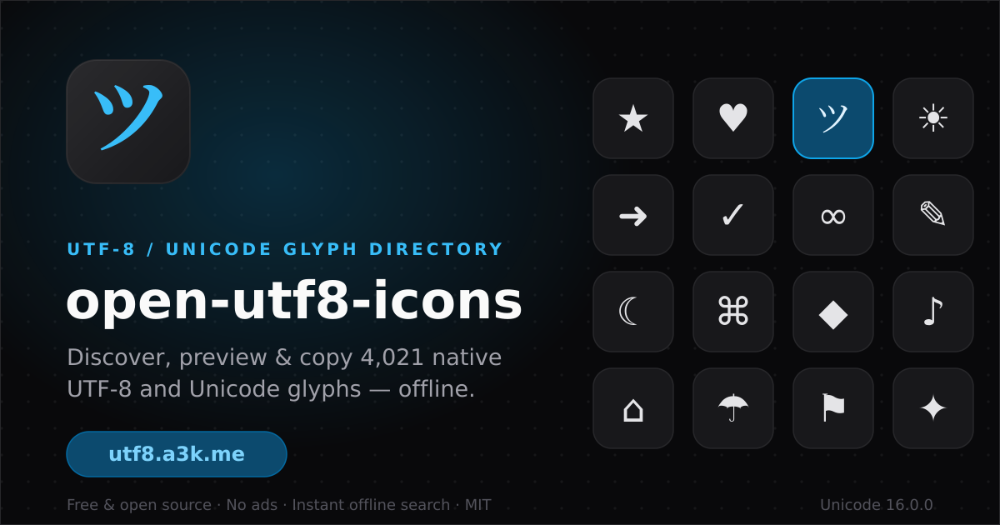

# open-utf8-icons `ツ`

[](https://bun.sh)
[](https://svelte.dev)
[](https://tailwindcss.com)
[](https://utf8.a3k.me)
[](LICENSE)

A fast, lightweight, ad-free, open-source web directory for discovering, previewing, and copying native UTF-8 and Unicode glyphs.

Hosted at: **[utf8.a3k.me](https://utf8.a3k.me)**

---

## ✦ Core Tenets

1. **Zero Icon Libraries / Zero SVG Icons**: We strictly dogfood our own domain. Every UI icon (search, copy, close, theme toggle, navigation, arrows) is a native UTF-8 Unicode character. No Lucide, Heroicons, FontAwesome, or custom SVG packs.
2. **Minimal Dependencies**: Pure browser APIs, Svelte primitives, and Bun built-ins.
3. **Offline-First & PWA**: Instant local search without network latency, installable on mobile and desktop.
4. **Visual Identity**: Japanese Katakana Letter Tu (`ツ` / `U+30C4`) serves as the logo and favicon.

---

## 🛠 Tech Stack

- **Runtime & Toolchain**: [Bun](https://bun.sh) (package manager, test runner, bundler)
- **Framework**: [SvelteKit](https://svelte.dev) with **Svelte 5 Runes** (`$state`, `$derived`, `$props`, `$effect`)
- **Deployment**: Cloudflare Pages / Workers via [`@sveltejs/adapter-cloudflare`](https://github.com/sveltejs/kit/tree/main/packages/adapter-cloudflare)
- **Styling**: [Tailwind CSS v4](https://tailwindcss.com) with `@tailwindcss/vite`
- **PWA**: Hand-rolled service worker + web app manifest — no Workbox or PWA plugin
- **Testing**: Built-in `bun test`

---

## 🚀 Getting Started

### Prerequisites

- [Bun](https://bun.sh) (v1.2+)

### Development

```bash
# Clone the repository
git clone https://github.com/amr3k/open-utf8-icons.git
cd open-utf8-icons

# Install dependencies
bun install

# Start local development server
bun run dev

# Run unit tests
bun test

# Run Svelte type-checking
bun run check

# Regenerate the Unicode dataset (see below)
bun run generate:icons

# Build for production (Cloudflare Pages)
bun run build

# Preview production build locally
bun run preview
```

---

## 🗃 Unicode Dataset

The app is powered by a self-contained, pre-generated dataset — [`src/lib/data/icons.json`](src/lib/data/icons.json) — containing **3,965 glyphs** across 22 curated categories, extracted from **Unicode 16.0.0**.

Every glyph resolves to full developer metadata: character, official Unicode name, code point (`U+XXXX`), decimal value, HTML entities (decimal + hex), CSS escape, JS escape, Unicode category, script, block and curated search keywords. Country flags are included as regional-indicator emoji sequences (`🇺🇸`).

### Packed wire format

The committed artifact is a *packed* dataset (schema v2) rather than one object per glyph: it stores one row per glyph (`hex|name|category|script|block|keywords`), keeps block/category/script names in small dictionaries, drops keywords the glyph name already covers, and omits every representation that can be derived from the code points. [`src/lib/data/unpack.ts`](src/lib/data/unpack.ts) expands it once at load, so the browser receives **~162 kB raw / ~40 kB gzip instead of ~1.14 MB** and parses a compact JSON payload instead of a megabyte of JavaScript object literals.

### Regenerating the dataset

```bash
bun run generate:icons                              # use the pinned Unicode version
bun run generate:icons --force                      # re-download the UCD source files
bun run generate:icons --unicode 17.0.0             # extract from a newer Unicode version
bun run generate:icons --ucd ./UnicodeData.txt      # use a local/offline UnicodeData file
bun run generate:icons --scripts ./Scripts.txt      # use a local/offline Scripts file
```

- **Source of truth**: the official UCD [`UnicodeData.txt`](https://www.unicode.org/Public/16.0.0/ucd/UnicodeData.txt) (names, categories) and [`Scripts.txt`](https://www.unicode.org/Public/16.0.0/ucd/Scripts.txt) (script property) — downloaded once, then cached in `.cache/` (git-ignored), so repeat runs and CI work offline.
- **Curation**: the curated block list lives in `scripts/lib/blocks.ts`, hand-picked search synonyms in `scripts/lib/keywords.ts`, and flag regions in `scripts/lib/flags.ts`. Script ranges are parsed in `scripts/lib/unicode-scripts.ts`. Religious-sign policy lives in `scripts/lib/religion.ts`: Islamic glyphs (`☪`, `🕋`, `🕌`) are kept and other traditions' symbols are excluded at generation time.
- **Output**: minified packed JSON (~162 kB raw / ~40 kB gzip). The generated file is committed, so production builds and CI never need network access; Cloudflare serves it compressed. The generator prints the expanded-vs-packed saving on every run.
- **Invariants**: `bun test` validates the committed artifact end to end — it decodes the packed rows, checks dictionary indexes, and re-derives every developer representation with the pure helpers in [`src/lib/data/derive.ts`](src/lib/data/derive.ts), so representation drift fails CI.

---

## 🔎 Core Directory & Search

The homepage is a fully offline, client-side directory over the dataset — no network calls, no search index downloads.

- **Instant search** (pure `src/lib/search.ts`, zero dependencies): exact glyph / name / word / keyword matches, name & keyword prefixes and substrings, code point lookups in every notation (`u+2605`, `0x2605`, `2605`, `9733`), code point prefixes, and greedy fuzzy subsequences over names **and keywords** (word-start and prefix-anchored matches score highest). Equal scores prefer shorter, more canonical names. The per-glyph index is built lazily on the first keystroke, so the initial page load never pays for it; warm cost over the full 3,965-glyph index is **2–6 ms per keystroke**.
- **Keyboard shortcuts**: `/` focuses the search field from anywhere, `Esc` clears it from anywhere (or blurs when already empty).
- **Category browser**: horizontally scrollable block chips with live counts; the filter composes with search.
- **Windowed grid**: cards render in 48-glyph pages, grown by an IntersectionObserver sentinel as you scroll, and each card uses `content-visibility: auto` so off-screen tiles skip painting entirely — smooth scrolling with zero virtualization dependencies. Every match stays reachable — no result truncation.
- **Quick copy**: the 📋 corner button on any glyph copies it in the selected format (Char / HTML / CSS / `U+`), confirmed by a toast — Web Clipboard API with a legacy `execCommand` fallback.

---

## 🔬 Glyph Inspector & Developer Tooling

Clicking any glyph opens an accessible slide-over inspector (native `<dialog>` — focus trap, `Esc` and focus restoration included).

- **High-contrast preview**: the glyph rendered at display size on an inverted surface.
- **Cross-font rendering grid**: the same glyph in System UI, Sans-Serif, Serif and Monospace stacks, so you can spot missing-glyph fallbacks before shipping.
- **Every developer format, one click away**: character, decimal & hex HTML entities, CSS escape, JavaScript escape, URL-encoded UTF-8, and the `U+` code point.
- **Unicode attributes**: category (code + friendly label), block, script, decimal and hex values.
- **Shareable permalinks**: every inspection adds a fragment entry (`#U+2605`, or `#U+1F1FA-U+1F1F8` for flags), so the exact glyph can be reloaded or shared. Closing the inspector scrubs the fragment in place, and Back/Forward only ever dismisses the panel instead of reviving an older glyph.
- **Favorites & recent copies**: persisted in `localStorage` (`utf8:favorites`, `utf8:recents`), capped at 24 recent copies, and browsable from the All / ★ Favorites / 🕘 Recent switcher above the grid — no account, no server.

---

## 📲 PWA & Offline Support

`utf8.a3k.me` installs as a Progressive Web App and keeps working when the network does not — all without a PWA plugin or extra runtime dependencies.

- **Manifest**: [`static/manifest.webmanifest`](static/manifest.webmanifest) declares `open-utf8-icons`, a `/` scope, standalone display, categories, light theme/background colors and 192/512 px any + maskable icons (plus a 180 px `apple-touch-icon`), all rendered from the `ツ` brand mark.
- **Service worker** ([`src/service-worker/index.ts`](src/service-worker/index.ts), strategies in [`src/lib/sw-policy.ts`](src/lib/sw-policy.ts)): on install it precaches the app shell, every static asset (manifest, icons, favicon) and the immutable JS bundle — which already contains the full Unicode dataset, so offline search needs no extra request. Navigations are network-first, even for the cached root, with the cached shell as fallback; immutable build output is cache-first and other same-origin GETs revalidate in the background. Each deployment gets a versioned cache; older caches are pruned on activation. The worker is disabled during `vite dev` so HMR stays fresh.
- **Offline fallback**: a prerendered `/offline` page is precached and served for navigations that have no cached page, with a retry action. Prerendered asset URLs are root-relative, so the fallback renders correctly even when it answers a nested offline navigation. An unobtrusive status pill appears while `navigator.onLine` is false and verifies Cache Storage holds the shell before promising cached search, inspection and copying.
- **Install prompt**: Chromium's `beforeinstallprompt` is captured by an inline bootstrap before hydration and surfaced as a small, dismissible floating banner at the bottom of the screen on touch-first devices (a fixed layer, so it can never shift the page); iOS gets the equivalent Share → Add to Home Screen hint. Dismissals are remembered in `localStorage` (`utf8:install-dismissed`), and the banner never appears in standalone mode.

---

## 🎨 Branding, SEO & Social Assets

The brand mark is `ツ` (`U+30C4`), drawn from the same system font stack as the header — no bespoke icon packs or SVG sprites.



- **Favicon set**: [`static/favicon.svg`](static/favicon.svg) is the crisp vector source for modern browsers; `favicon-16.png` and `favicon-32.png` provide pixel-perfect PNG fallbacks, while `favicon.ico` covers legacy tab UIs. The 180 px `apple-touch-icon` and the 192/512 px PWA icons handle home screens.
- **Social card**: [`static/og-image.png`](static/og-image.png) is a 1200×630 Open Graph / Twitter card highlighting the `ツ` mark, the glyph directory and `utf8.a3k.me`. Its source lives in [`scripts/assets/og-image.svg`](scripts/assets/og-image.svg); the render command is documented at the top of the SVG.
- **Metadata**: [`src/app.html`](src/app.html) owns the favicon, manifest, application-name and theme-color shell; [`src/routes/+layout.svelte`](src/routes/+layout.svelte) renders the description, Open Graph and Twitter `summary_large_image` tags from the tested constants in [`src/lib/seo.ts`](src/lib/seo.ts). Canonical and `og:url` are derived per route, so query strings and fragments never split the index.
- **Browser chrome**: `theme-color` follows the resolved light/dark theme. A pre-hydration bootstrap paints the correct color before first paint, and the runtime theme manager keeps it in sync when the mode changes.
- **Crawlers**: [`static/robots.txt`](static/robots.txt) advertises [`static/sitemap.xml`](static/sitemap.xml); the prerendered `/offline` fallback is marked `noindex`.

---

## 🤝 Contributing

Contributions are welcome — especially curated keywords, block coverage, and accessibility fixes.

1. Read [`AGENTS.md`](AGENTS.md); it is the working contract for this repository.
2. Use **Bun** only (`bun install`, `bun test`, `bun run check`, `bun fmt`). Do not add npm or npx lockfiles.
3. Keep the icon philosophy: every UI control is a native UTF-8 glyph. No Lucide, Heroicons, FontAwesome, or custom SVG icon packs.
4. Reach for a native browser API before adding a dependency; the dependency surface is intentionally tiny.
5. Branch from `main` as `feat/<issue-id>-<slug>` or `fix/<issue-id>-<slug>`, and reference the issue in commits and pull requests.
6. Before opening a pull request, run:

   ```bash
   bun test
   bun run check
   bun run build
   bun fmt --check
   ```

7. If you touch the extraction pipeline, regenerate and commit `src/lib/data/icons.json` with `bun run generate:icons`.

---

## 📋 Implementation Roadmap

Tracked in epic issue [#1](https://github.com/amr3k/open-utf8-icons/issues/1):

- [x] **Phase 1: Project Scaffolding & Toolchain**
- [x] **Phase 2: Unicode Dataset Extraction Pipeline**
- [x] **Phase 3: Core Directory & Search Interface**
- [x] **Phase 4: Glyph Inspector & Developer Tooling**
- [x] **Phase 5: PWA & Offline Support**
- [x] **Phase 6: Branding, SEO & Social Assets**
- [ ] **Phase 7: Deployment & CI/CD**

---

## 📄 License

[MIT](LICENSE) &copy; 2026 Amr (@amr3k)
